# Network Traffic Analysis & IDS Home Lab (Wireshark + Suricata + Wazuh)

This is the second lab in my SOC home-lab series. In the first lab ([wazuh-siem-home-lab](https://github.com/Binz00/wazuh-siem-home-lab)) I worked with host logs in Wazuh. In this one I moved to the network side: I learned to read packets in Wireshark, investigated a real malware infection from a packet capture, set up Suricata as an IDS, attacked my own VM with Nmap, and sent the Suricata alerts into Wazuh so everything ends up in one place.

I'm still new to network security, so I've written down what I did, what went wrong, and what I learned at each step.

---

## 1. What I wanted to learn

- How normal traffic (DNS, HTTP, HTTPS, the TCP handshake) looks in Wireshark, so I can spot traffic that isn't normal
- How a SOC analyst investigates an alert using only a packet capture: finding the infected computer, the user, and how the infection happened
- How to install and configure Suricata with the free ET Open ruleset
- What Nmap scans look like from the defender's side
- How to get Suricata alerts into Wazuh, and how to tune them so the important ones stand out
- How to write my own detection rules

---

## 2. Lab setup

Everything runs on my MacBook (Apple Silicon) using UTM virtual machines on a private network (`192.168.64.0/24`).

| Role | Machine | IP | Software |
|---|---|---|---|
| Attacker | MacBook | 192.168.64.1 | Nmap 7.993 |
| Target + IDS sensor | Kali Linux 2026.3 (ARM64 VM) | 192.168.64.10 | Suricata 8.0.8, Wireshark 4.6.9, Wazuh agent 4.14.10 |
| SIEM | Ubuntu Server 20.04.5 (ARM64 VM) | 192.168.64.9 | Wazuh 4.14.10 (manager, indexer, dashboard) |

How the data flows:

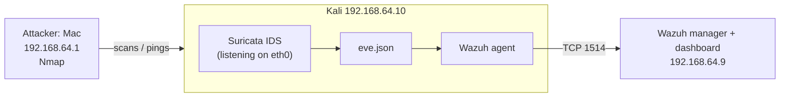

Suricata watches Kali's network card, writes alerts to `eve.json`, the Wazuh agent on Kali reads that file, and the alerts show up on the Wazuh dashboard.

---

## 3. Part 1: Learning Wireshark with my own traffic

Before looking at malware, I wanted to know what normal traffic looks like. I started a capture on `eth0` and generated some traffic with `nslookup`, `curl` (HTTP and HTTPS) and `ping`.

I added my user to the `wireshark` group instead of running Wireshark as root. That way only the small capture tool (`dumpcap`) gets the extra permissions.

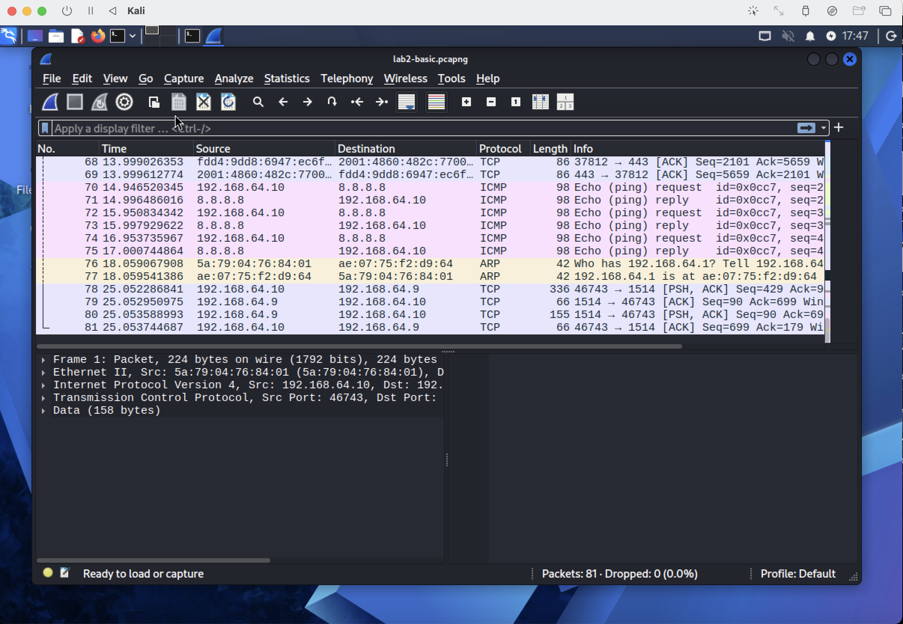

Display filters I practised:

| Filter | What I saw |
|---|---|
| `dns` | A (IPv4) and AAAA (IPv6) lookups sent to 192.168.64.1. Each query and its answer share the same transaction ID. |
| `http` | `GET / HTTP/1.1` and `200 OK`. Plain HTTP is fully readable, including the `User-Agent: curl/8.22.0` header. |
| `tls.handshake.type == 1` | The TLS Client Hello. Even though HTTPS is encrypted, the **SNI** field showed the website name (`www.google.com`) in clear text. |
| `tcp.flags.syn == 1 && tcp.flags.ack == 0` | Only 2 new TCP connections during normal browsing. This becomes important later when I compare it with a port scan. |
| `tcp.stream eq 1` | One full connection: the 3-way handshake (SYN, SYN-ACK, ACK), the HTTP data, then the FIN packets that close it. |
| `tcp.port == 1514` | My own Wazuh agent sending logs to the manager. Good to know, so I don't confuse it with something suspicious. |

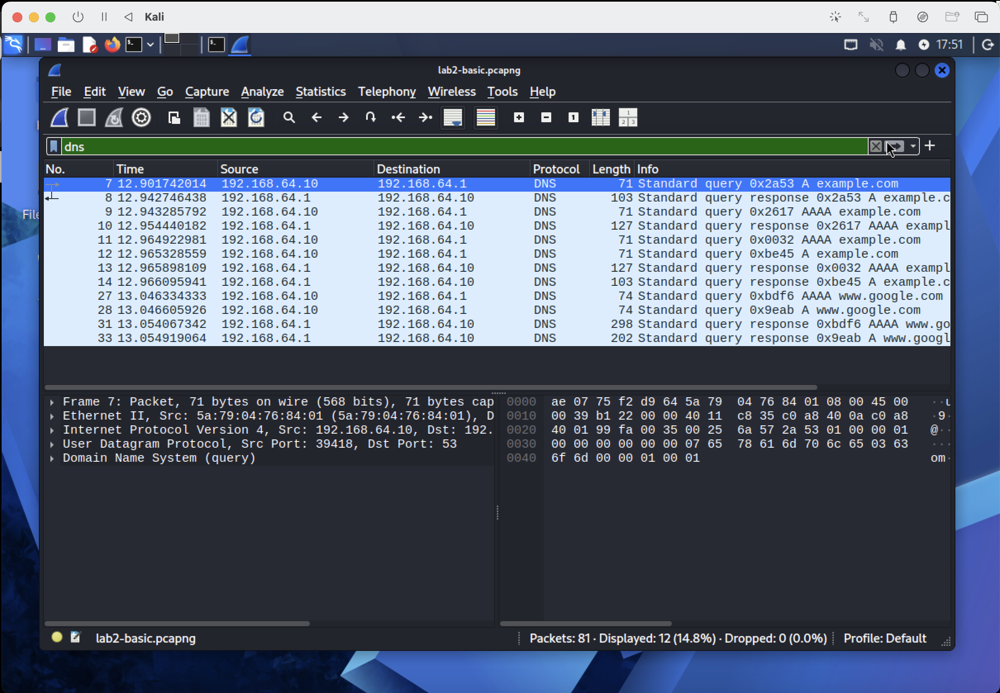
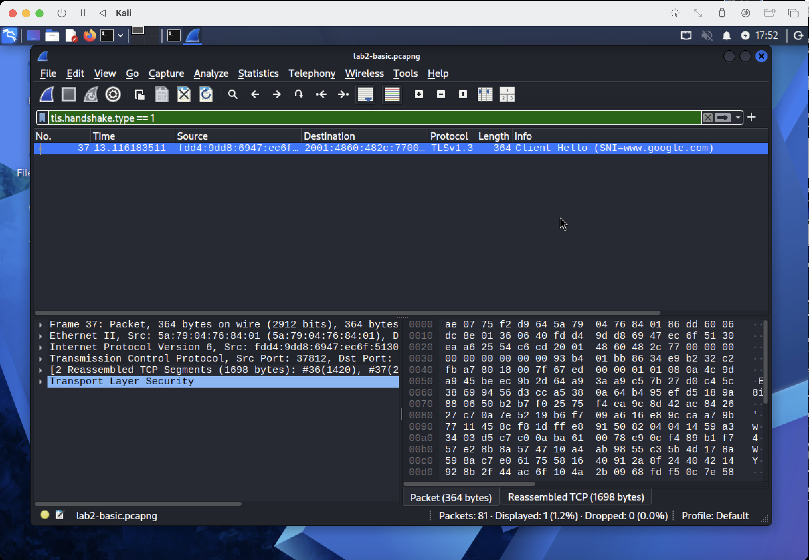
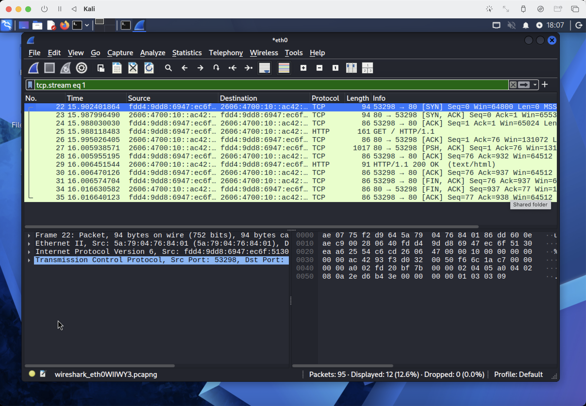
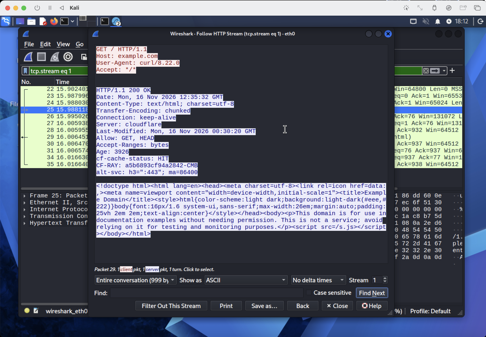
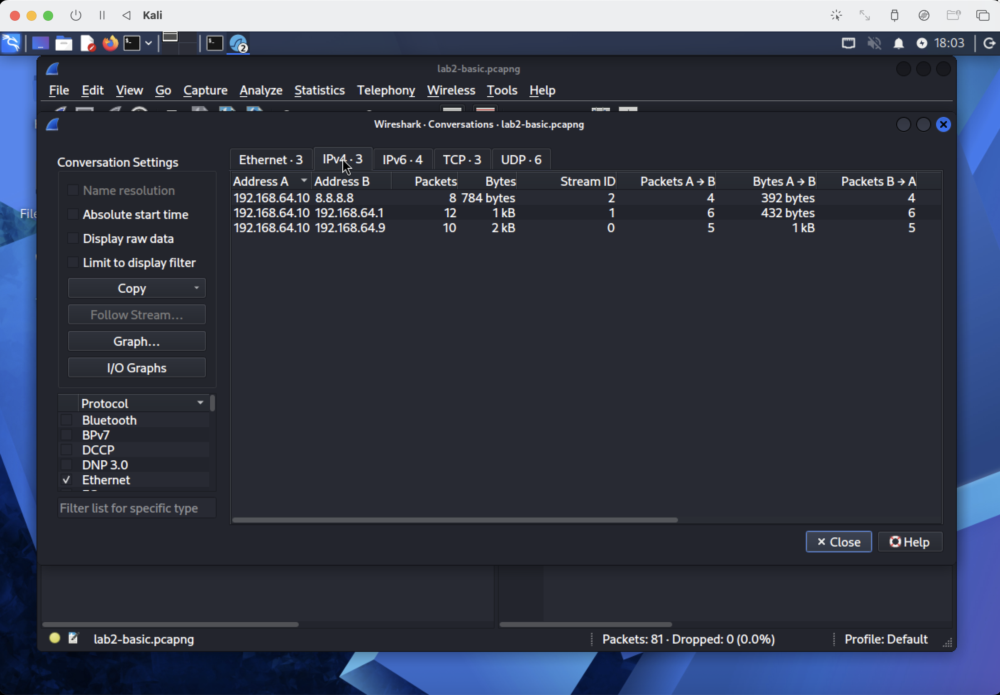

**Something that confused me:** the IPv4 tab in Statistics → Conversations was empty at first. It turned out "Limit to display filter" was ticked, and my filter (`http`) only matched IPv6 packets. After clearing the filter, the three conversations appeared: the ping to 8.8.8.8, DNS to the Mac, and the Wazuh agent traffic.

---

## 4. Part 2: Investigating a real malware capture ("The Lucky Turkey")

For this part I used a training exercise from [malware-traffic-analysis.net](https://www.malware-traffic-analysis.net/) (2026-11-10, "The Lucky Turkey"). I downloaded and opened it only inside the Kali VM. My full notes are in [`findings/lucky-turkey-investigation.md`](findings/lucky-turkey-investigation.md).

**The scenario:** I'm a SOC analyst and an alert fired for **NetSupport RAT** (a remote access trojan) talking to `93.152.209[.]36` on port 443. I had the packet capture from the Windows computer and needed to confirm the alert and find out who was infected.

First, I recorded the file's SHA256 hash, so it's clear exactly which file I analysed:
`b52bd2a4ec9d747266206e10df01283197cc3e8ace8af20f1c1e5fb8f0b61533`

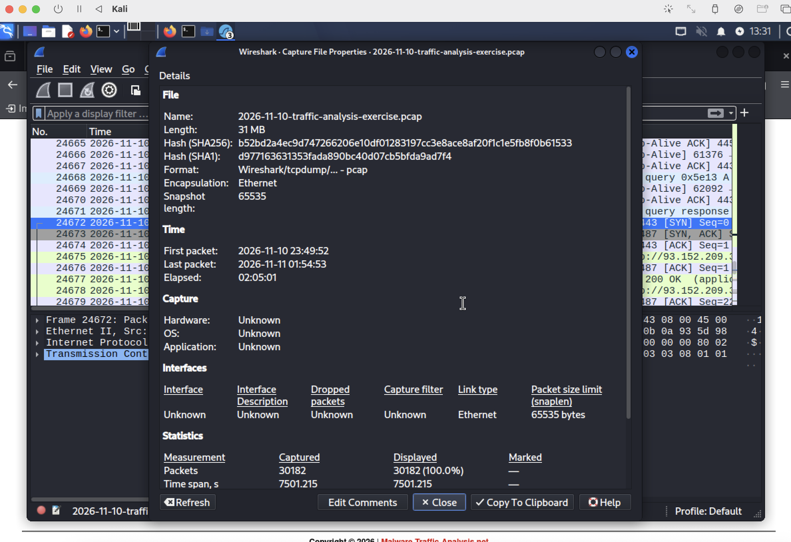

### 4.1 Finding the infected computer

I changed Wireshark's time display to UTC, because the questions ask for a date and time and reports should use one time zone.

| Question | My answer | How I found it |
|---|---|---|
| When did the RAT traffic start? | **2026-11-10 18:22:07 UTC** | Filtered `ip.addr == 93.152.209.36` and took the first packet |
| Infected computer's IP | **10.11.10.147** | Source of the first SYN packet to the bad IP |
| MAC address | **00:12:f0:e5:17:43** (Intel card) | Ethernet II → Source |
| Host name | **DESKTOP-5OMVI3L** | NBNS packets (Windows announces its name on the network) |
| User account | **edward.winslow** | Kerberos login packets, filtering out names ending in `$` |

All 5 answers matched the official answer key.

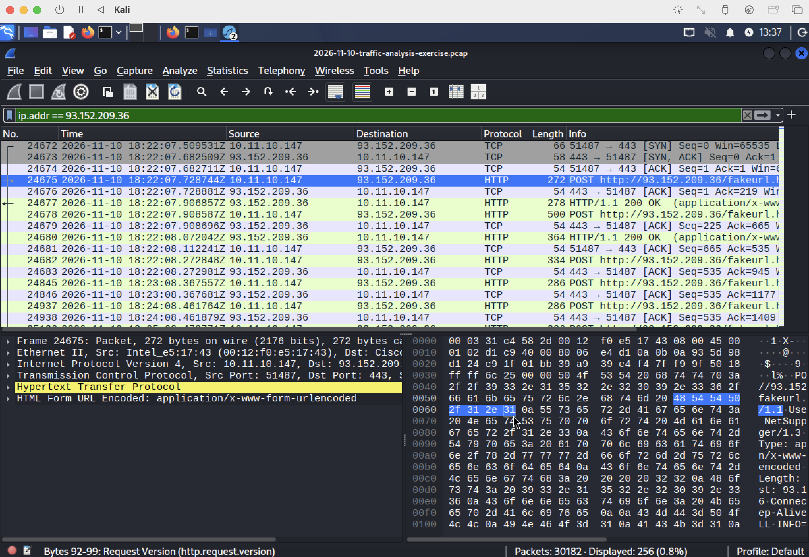
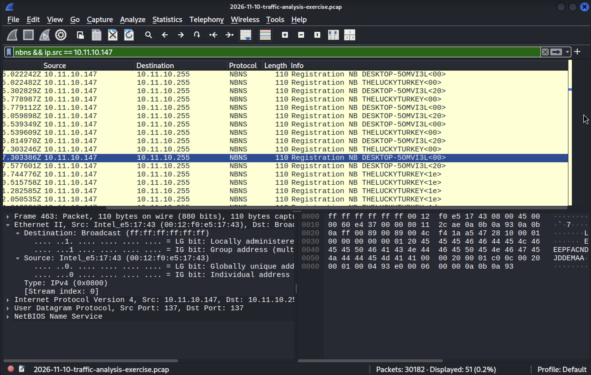

**Mistakes I made along the way:**
- My first answer for the start time was the first packet of the *whole* recording, shown in Sri Lanka time. The question asked for the first *RAT* packet, in UTC.
- For the user name I first picked `DESKTOP-5OMVI3L$`. Names ending in `$` are **computer accounts** in Active Directory, not people, so I filtered those out: `kerberos.CNameString && !(kerberos.CNameString contains "$")`.
- The host name looked like it could contain a zero or the letter O, so I checked the hex bytes. It was `4f`, the letter O.

**Things I noticed in the C2 traffic:**
- The infected PC sent `POST /fakeurl.htm` requests with `User-Agent: NetSupport Manager/1.3`.
- It used port 443 but **without encryption**. Port 443 is normally HTTPS, so plain HTTP on it is a red flag.
- The requests repeated every ~60 seconds. This is called **beaconing**: the malware checking in with its server for commands.

### 4.2 How the computer got infected

Next, I wanted to know what happened in the ~2 minutes between the user logging in (18:20:14) and the RAT starting (18:22:07). I listed every website visited before the first RAT packet:

`(http.request || tls.handshake.type == 1) && frame.number < 24672`

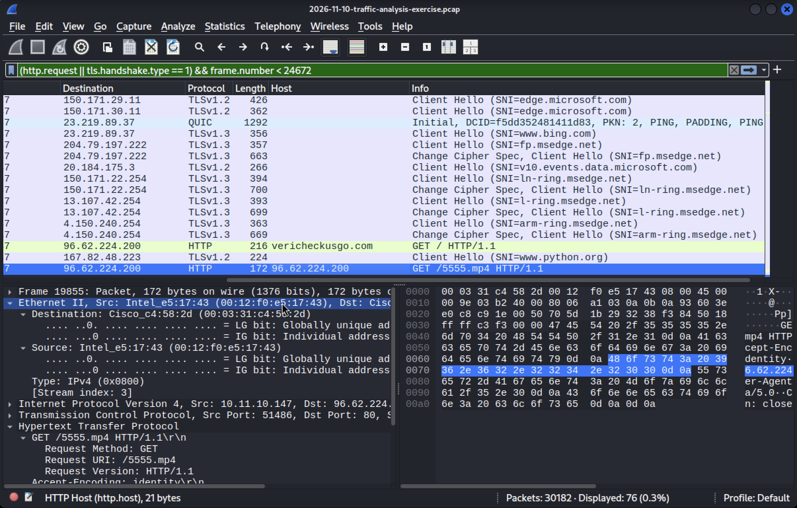

Most entries were normal Microsoft and Bing traffic. Three stood out:
- `vericheckusgo.com` over plain HTTP (an unknown, made-up looking domain)
- `www.python.org` (a real site, but an office user rarely downloads Python)
- `GET /5555.mp4` from the **same IP** as vericheckusgo.com, requested by IP address instead of a name

Following the HTTP streams showed the chain:

| Time (UTC) | What happened |
|---|---|
| 18:20:14 | edward.winslow logs in (Kerberos AS-REQ) |
| ~18:21:50 | **PowerShell** downloads a script from `vericheckusgo[.]com`. The User-Agent was `WindowsPowerShell/5.1`, not a browser. The server labelled it as `text/html`, but it was a PowerShell script. |
| 18:21:50 to 18:21:59 | The script downloads a portable Python 3.12.7 from python.org into a hidden folder |
| 18:21:59 | Python downloads `5555.mp4` from `96.62.224[.]200` |
| **18:22:07** | NetSupport RAT starts talking to `93.152.209[.]36` |

I read the script without running it. Parts of it were hidden with **Base64** encoding, so I decoded those strings in the Kali terminal (`echo '...' | base64 -d`). This is what it does:
- Stops if the computer name contains `CLEAN` (a trick to avoid running inside analysis sandboxes)
- Hides its own window
- Stops if the file `C:\ProgramData\.ch_d5855b208b12` already exists, so it doesn't infect the same PC twice
- Saves a Python script to the Temp folder, installs Python from python.org, and runs it hidden

The part that surprised me most was `5555.mp4`. It starts with a real MP4 header (`ftyp isom`), so it looks like a genuine video. The Python script searches inside it for a hidden section (an MP4 `uuid` box), decrypts it with XOR, decompresses it, and runs the result. Hiding code inside a normal-looking file is called **steganography**. Lesson for me: a correct file header doesn't prove a file is safe. A script downloading a "video" from a bare IP address is suspicious on its own.

Since the first download came from PowerShell, the user was probably tricked into pasting a command (a "ClickFix" style fake verification page). I can't prove this from the capture alone, though.

### 4.3 IOCs (defanged so they can't be clicked)

| Type | Indicator |
|---|---|
| Domain | `vericheckusgo[.]com` |
| IP | `96.62.224[.]200` (script and payload server) |
| URL | `hxxp://96.62.224[.]200/5555.mp4` |
| IP:port | `93.152.209[.]36:443` (NetSupport RAT C2) |
| URL | `hxxp://93.152.209[.]36/fakeurl.htm` |
| User-Agent | `NetSupport Manager/1.3` |
| Files/folders | `C:\ProgramData\.ch_d5855b208b12`, `%LOCALAPPDATA%\.v16c936eb5ae\`, `%TEMP%\ch_w_*.py`, `%TEMP%\chk_*.py` |

---

## 5. Part 3: Setting up Suricata

Wireshark only shows traffic when I look at it. An IDS like Suricata watches all the time and raises alerts automatically when traffic matches a known attack pattern (a **signature**).

```bash
sudo apt install -y suricata          # Suricata 8.0.8
sudo suricata-update                  # downloads the free ET Open rules
sudo suricata -T -c /etc/suricata/suricata.yaml -v   # test the config
sudo systemctl enable --now suricata  # start now and on every boot
```

Settings I checked or changed in `/etc/suricata/suricata.yaml` (copies in [`configs/`](configs/)):

| Setting | Value | Why |
|---|---|---|
| `HOME_NET` | `"[192.168.64.10/32]"` | This was the most important change. The default included every private range, which made my attacking Mac count as "home". Many scan rules only fire for traffic from outside (`$EXTERNAL_NET`) to inside (`$HOME_NET`), so I set HOME_NET to just Kali. |
| `EXTERNAL_NET` | `"!$HOME_NET"` (default) | Everything that isn't Kali |
| `af-packet` interface | `eth0` | The network card Suricata listens on |
| `rule-files` | `suricata.rules` + `local.rules` | ET Open rules plus my own |

The config test loaded **53,495 rules with 0 failures**.


**Testing it:** the usual test (`curl http://testmynids.org/uid/index.html`) gave no alert. When I read the response, the domain had expired and now just shows "This domain may be for sale". So I made my own test ([`scripts/ids-test-server.sh`](scripts/ids-test-server.sh)): a small Python web server on Kali that serves the text `uid=0(root)`, which is what the Linux `id` command prints for the root user. I downloaded it from the Mac, and Suricata raised **SID 2100498** (GPL ATTACK_RESPONSE id check returned root) and **SID 2019284**.

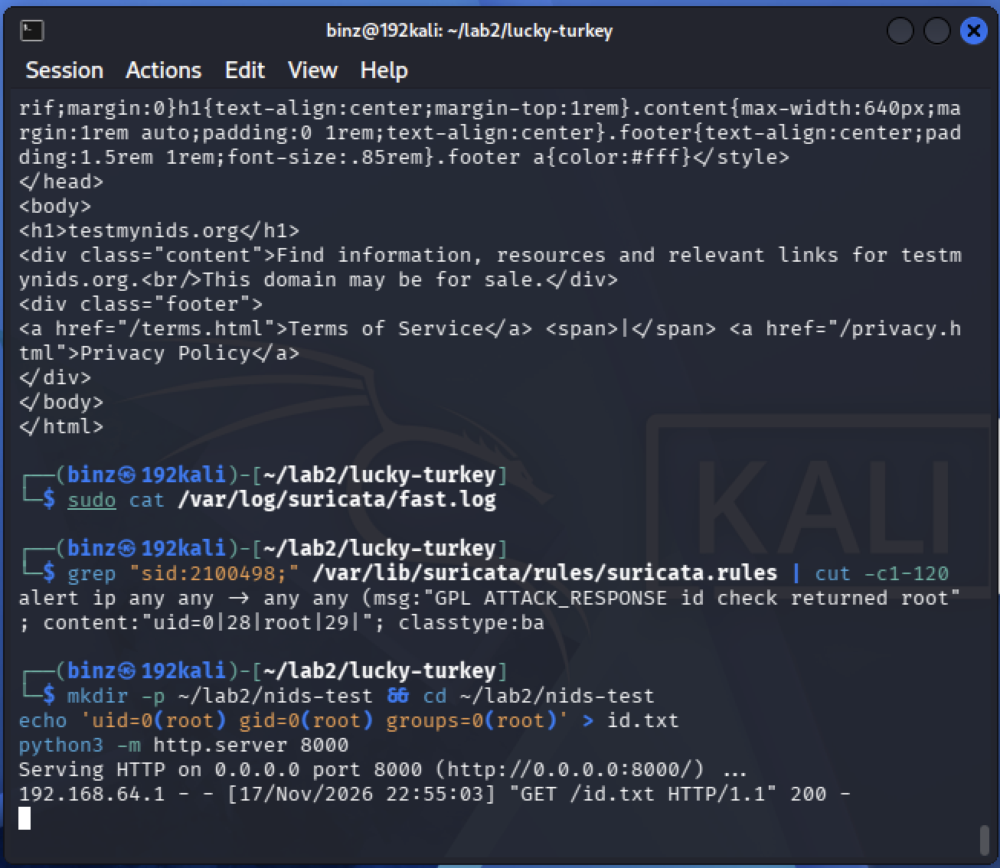

---

## 6. Part 4: Scanning Kali with Nmap and watching the alerts

I scanned Kali from the Mac while watching Wireshark and Suricata's `fast.log` at the same time. Commands are in [`scripts/nmap-scans.sh`](scripts/nmap-scans.sh), and the outputs are in [`evidence/nmap-scan-results.txt`](evidence/nmap-scan-results.txt).

| Scan | What it does | What Suricata detected |
|---|---|---|
| `nmap -sS` | SYN scan: knocks on 1,000 ports without completing the handshake | Probes to database ports (MySQL 3306, MSSQL 1433, PostgreSQL 5432, Oracle 1521) and VNC |
| `nmap -sV -sC -p 22,8000` | Finds service versions and runs default scripts | **Nmap Scripting Engine User-Agent** (Priority 1), Potential SSH Scan, protocol anomalies |
| `nmap -O` | Guesses the operating system | **NMAP OS Detection Probe**, ICMPv4 unknown code |

In Wireshark the SYN scan was easy to recognise: **exactly 1,000 SYN packets in 0.06 seconds**, all from one source port to many different ports. During normal browsing there were only 2.

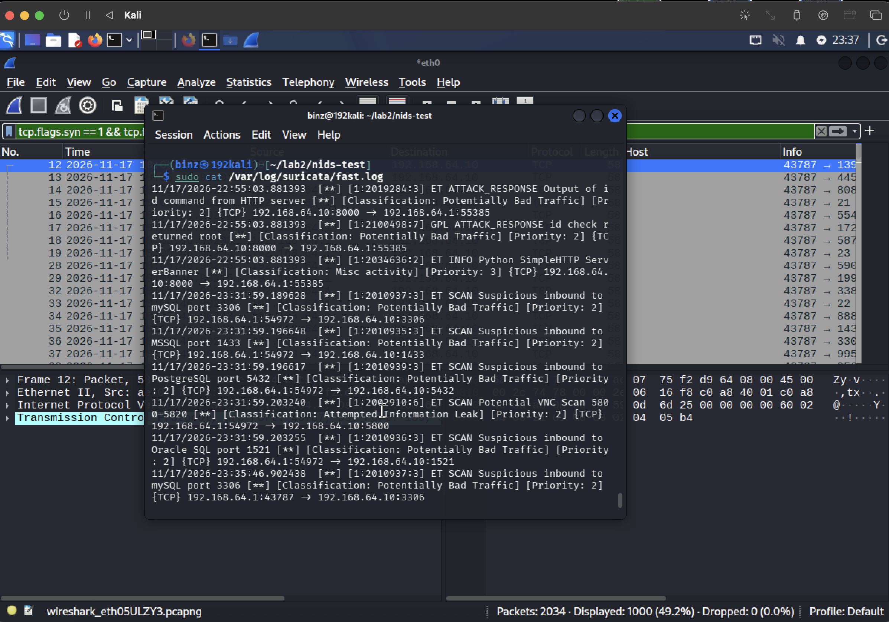
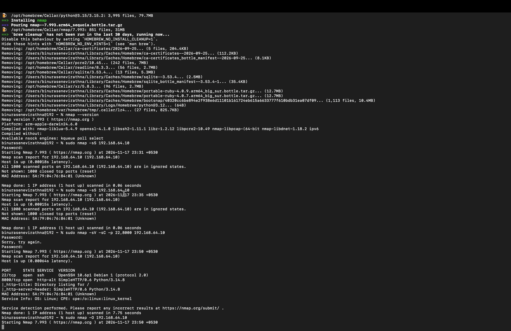

I counted all alerts by signature with a short command ([`scripts/suricata-alert-summary.sh`](scripts/suricata-alert-summary.sh)):

| Count | Alert | My view |
|---|---|---|
| 36 | ET INFO Python SimpleHTTP ServerBanner | Noise, caused by my own test server |
| 34 | SURICATA ICMPv4 unknown code | Side effect of OS detection |
| 29 | **ET SCAN Nmap Scripting Engine User-Agent** | Clearest sign of an attack tool |
| 5 | ET SCAN NMAP OS Detection Probe | Reconnaissance |
| 3 each | ET SCAN database ports / VNC | Port scan |
| 1 | ET SCAN Potential SSH Scan | Reconnaissance |

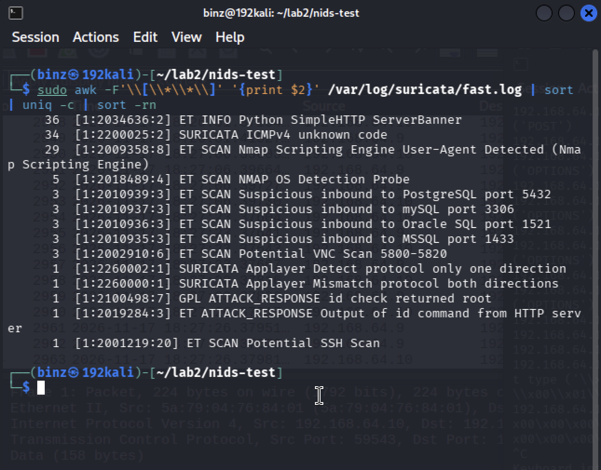

**Two things I learned here:**
- More than half the alerts (70 of 124) were noise or low value. Too many low-value alerts is called **alert fatigue**, and it's a real problem in SOCs.
- Nmap touched 1,000 ports, but Suricata only alerted on 5. The rules look for specific sensitive ports, not "lots of ports from one IP". That's a **detection gap**, and it would need a threshold rule or SIEM correlation to close.

---

## 7. Part 5: Sending Suricata alerts to Wazuh

In a real SOC, analysts don't log in to each machine to read log files. Everything goes to the SIEM. So I told the Wazuh agent on Kali to also read Suricata's `eve.json` file ([`configs/kali-ossec-localfile.xml`](configs/kali-ossec-localfile.xml)):

```xml
<ossec_config>
  <localfile>
    <log_format>json</log_format>
    <location>/var/log/suricata/eve.json</location>
  </localfile>
</ossec_config>
```

After restarting the agent, its log confirmed: `Analyzing file: '/var/log/suricata/eve.json'`.

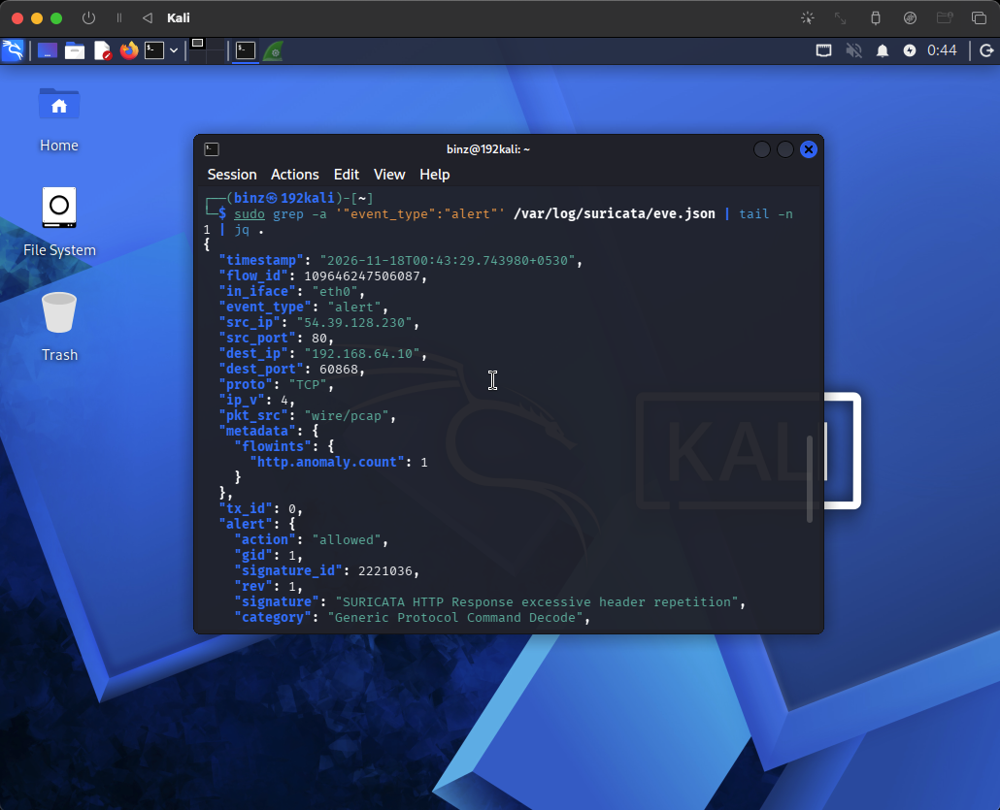
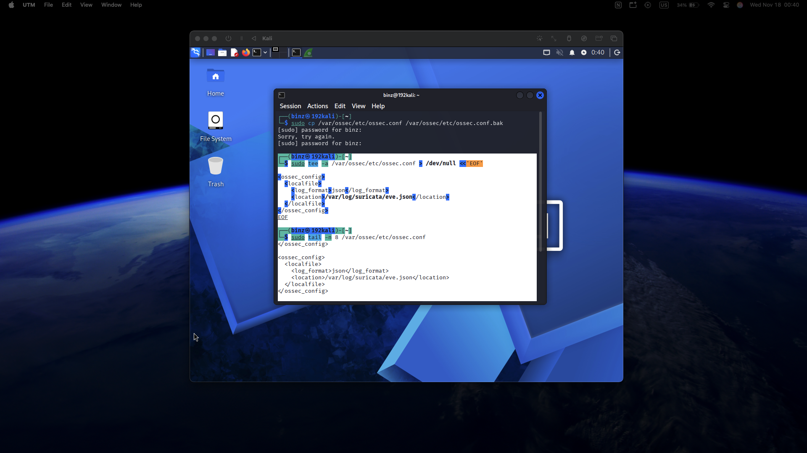

In the Wazuh dashboard (Threat Hunting → Events), I searched `rule.groups:suricata` and added the columns `data.alert.signature`, `data.src_ip` and `data.dest_port`.

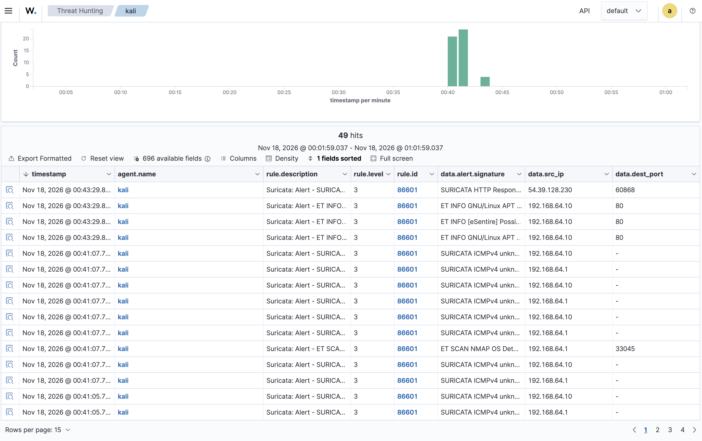

**Problem I noticed:** Wazuh's built-in rule (86601) gives **every** Suricata alert **level 3**. So an Nmap OS-detection probe had the same level as the alert from me installing a package with `apt`. That made the important alerts hard to see.

---

## 8. Part 6: Writing my own rules

### 8.1 Custom Wazuh rules to raise the important alerts

On the Wazuh manager I added two rules to `/var/ossec/etc/rules/local_rules.xml` ([`configs/wazuh-local_rules.xml`](configs/wazuh-local_rules.xml)). They build on top of rule 86601 and give a higher level to the alerts that matter:

```xml
<group name="suricata,custom_lab2,">
  <rule id="100101" level="12">
    <if_sid>86601</if_sid>
    <field name="alert.severity">^1$</field>
    <description>Suricata HIGH severity: $(alert.signature) from $(src_ip)</description>
    <mitre><id>T1595</id></mitre>
  </rule>
  <rule id="100100" level="10">
    <if_sid>86601</if_sid>
    <field name="alert.signature">^ET SCAN</field>
    <description>Suricata network scan: $(alert.signature) from $(src_ip)</description>
    <mitre><id>T1046</id></mitre>
  </rule>
</group>
```

- **100101:** if Suricata rated the alert severity 1 (its highest), raise it to level 12.
- **100100:** if the signature starts with "ET SCAN", raise it to level 10.
- I put 100101 first, because the Nmap Scripting Engine alert matches both rules and I wanted the higher level to win.
- Inside Wazuh rules, the fields are written without the `data.` prefix you see in the dashboard (`alert.signature`, not `data.alert.signature`).

I checked the file with `wazuh-analysisd -t` (exit code 0) before restarting the manager.

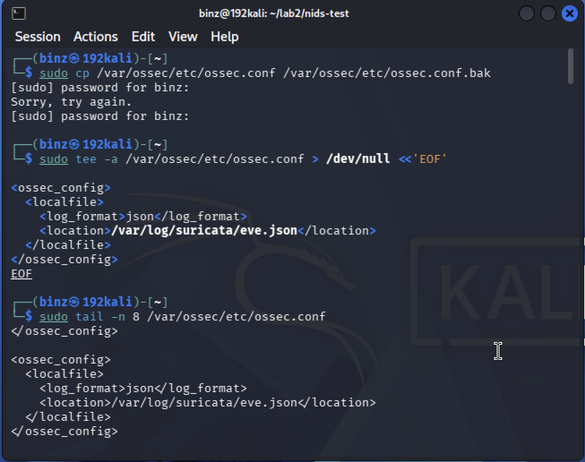

**Result** after one combined scan (`nmap -sS -sV -sC -O`), 111 Suricata alerts in total:

| Wazuh rule | Level | Alerts | What they were |
|---|---|---|---|
| 100101 | **12** | 29 | Nmap Scripting Engine |
| 100100 | **10** | 11 | Database/VNC port probes, SSH scan, OS detection |
| 86601 | 3 | 71 | Low-value or informational |

Sorted by level, the real scan activity is now at the top and the noise is at the bottom.

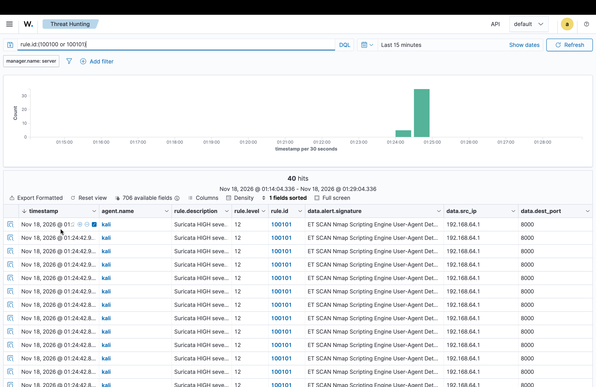
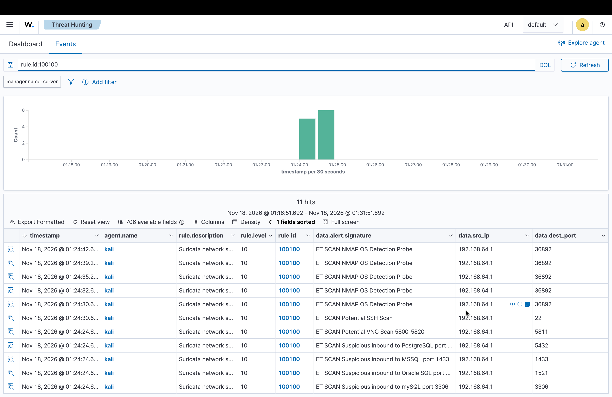
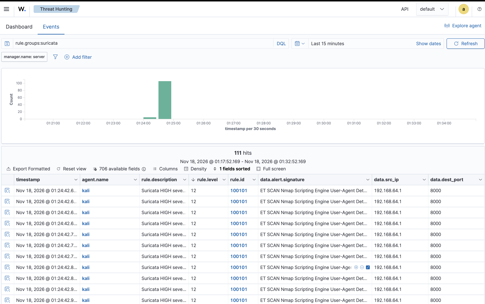

### 8.2 My own Suricata rule

To understand how signatures are built, I wrote a simple rule that alerts when someone pings Kali ([`configs/local.rules`](configs/local.rules)):

```
alert icmp any any -> $HOME_NET any (msg:"LAB2 ICMP Ping to Kali detected"; itype:8; classtype:misc-activity; sid:1000001; rev:1;)
```

- `itype:8` matches only ping requests (type 8), not the replies (type 0)
- `sid:1000001`: SIDs from 1,000,000 to 1,999,999 are reserved for your own local rules

I sent `ping -c 3 192.168.64.10` from the Mac and got **3 alerts** (one per request), both in `fast.log` and in Wazuh.

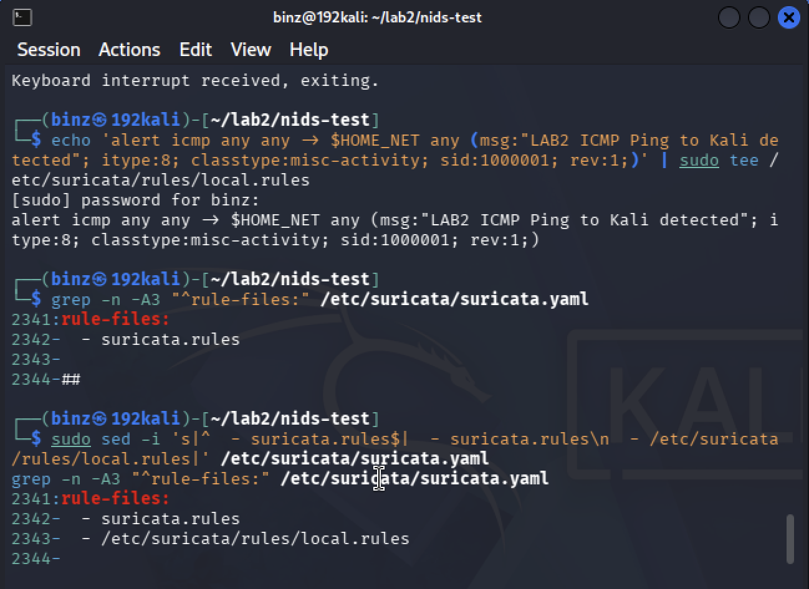
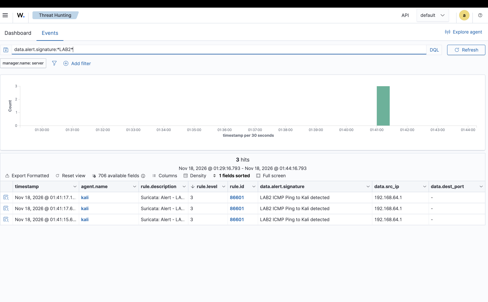

In a real network, pings happen all the time, so this rule would be noisy. I'd add a threshold such as `threshold: type limit, track by_src, count 1, seconds 60;` so it alerts at most once per minute for each source IP.

---

## 9. MITRE ATT&CK mapping

| Technique | Where it appears in this lab |
|---|---|
| T1046 Network Service Discovery | Nmap port and service scans (rule 100100) |
| T1595 Active Scanning | Nmap scripts and OS detection (rule 100101) |
| T1059.001 PowerShell | Lucky Turkey first stage |
| T1059.006 Python | Lucky Turkey second stage |
| T1027 Obfuscated Files | Base64-encoded strings in the script |
| T1027.003 Steganography | Payload hidden inside the MP4 file |
| T1105 Ingress Tool Transfer | Downloading Python and the MP4 payload |
| T1564.003 Hidden Window | Script hides its console window |
| T1497 Virtualization/Sandbox Evasion | The "CLEAN" computer-name check |
| T1219 Remote Access Software | NetSupport RAT |
| T1071.001 Web Protocols | C2 over HTTP on port 443 |

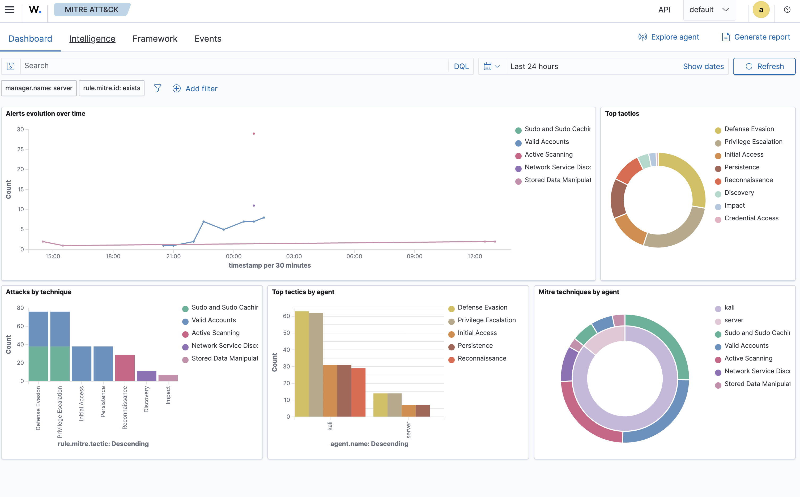

---

## 10. Problems I ran into (and how I fixed them)

| Problem | Cause | Fix |
|---|---|---|
| Wireshark didn't show my scan | I was looking at an old capture window; no new capture was running | Start the capture *before* running the attack |
| Conversations → IPv4 tab was empty | "Limit to display filter" was on, with an IPv6-only filter | Cleared the filter |
| No alert from testmynids.org | The domain has expired | Built my own `uid=0(root)` test server |
| Port 22 showed as closed | SSH wasn't set to start on boot | `sudo systemctl enable --now ssh` |
| `grep: eve.json: binary file matches` | Nmap probes put non-text bytes into the log | Used `grep -a` |
| Couldn't add `data.alert.*` columns in Wazuh | The index pattern's field list was saved before any Suricata data existed | Refreshed the `wazuh-alerts-*` field list (644 → 706 fields) |
| "No results" in Wazuh | The time filter (last 15 minutes) had moved past my alerts | Widened the time range |
| Custom Wazuh rules didn't work at first | The command that adds them hadn't been run on the manager | Ran it again, tested with `wazuh-analysisd -t`, restarted |
| Sorting by level still mixed the alerts | Timestamp was still the first sort field | Removed the timestamp sort |

---

## 11. What I practised

- Wireshark: display filters, Follow Stream, Statistics (Conversations, Protocol Hierarchy)
- Investigating a malware PCAP: finding the victim with NBNS and Kerberos, building a timeline, extracting IOCs
- Reading obfuscated PowerShell and Python safely (decoding Base64, never running it)
- Installing and tuning Suricata (ET Open rules, HOME_NET)
- Recognising Nmap scans in packets and in IDS alerts
- Sending a new log source into Wazuh (JSON localfile)
- Writing Wazuh custom rules and a Suricata signature
- Separating real alerts from noise, and mapping findings to MITRE ATT&CK

---

## 12. Repository structure

```
network-ids-traffic-analysis-lab/
├── README.md
├── .gitignore
├── configs/
│   ├── local.rules                  # my Suricata rule (SID 1000001)
│   ├── wazuh-local_rules.xml        # Wazuh rules 100100 / 100101
│   ├── kali-ossec-localfile.xml     # agent config for eve.json
│   ├── suricata-yaml-changes.txt    # HOME_NET, EXTERNAL_NET, interface
│   └── suricata-rule-files.txt      # rule-files section
├── scripts/
│   ├── nmap-scans.sh                # the scans I ran
│   ├── ids-test-server.sh           # safe uid=0(root) IDS test
│   └── suricata-alert-summary.sh    # count alerts by signature
├── findings/
│   └── lucky-turkey-investigation.md
├── evidence/
│   ├── nmap-scan-results.txt
│   └── suricata-alert-summary.txt
└── screenshots/
```

---

## 13. Screenshots

| # | File | Shows |
|---|---|---|
| 01 | `01-wireshark-live-capture.png` | Live capture on eth0 |
| 02 | `02-wireshark-dns-filter.png` | DNS queries and answers |
| 03 | `03-wireshark-tls-sni.png` | TLS Client Hello with SNI |
| 04 | `04-wireshark-tcp-handshake.png` | TCP handshake and connection close |
| 05 | `05-wireshark-follow-http-stream.png` | HTTP request and response |
| 06 | `06-wireshark-conversations.png` | Statistics → Conversations |
| 07 | `07-pcap-capture-file-properties.png` | Lucky Turkey file properties and SHA256 |
| 08 | `08-pcap-netsupport-c2-traffic.png` | NetSupport RAT C2 traffic |
| 09 | `09-pcap-nbns-hostname.png` | Host name from NBNS |
| 11 | `11-pcap-initial-access-requests.png` | Websites visited before the RAT |
| 15 | `15-suricata-test-alert-id-root.png` | Test alert for uid=0(root) |
| 17 | `17-nmap-syn-scan-suricata-alerts.png` | Scan alerts in fast.log |
| 18 | `18-nmap-service-os-scan.png` | Nmap version, script and OS scans |
| 19 | `19-suricata-alert-summary.png` | Alert counts by signature |
| 20 | `20-suricata-eve-json-alert.png` | One alert in eve.json |
| 21 | `21-wazuh-agent-eve-json.png` | Wazuh agent reading eve.json |
| 22 | `22-wazuh-suricata-alerts.png` | Suricata alerts in Wazuh |
| 23 | `23-wazuh-custom-rules-xml.png` | Custom Wazuh rules and config test |
| 24 | `24-wazuh-rule-100101-level12.png` | Nmap Scripting Engine alerts at level 12 |
| 25 | `25-wazuh-rule-100100-level10.png` | Scan alerts at level 10 |
| 26 | `26-wazuh-sorted-by-level.png` | Alerts sorted by level |
| 27 | `27-suricata-custom-rule-ping.png` | My ping rule firing |
| 28 | `28-wazuh-custom-suricata-rule.png` | Ping alerts in Wazuh |
| 29 | `29-wazuh-mitre-attack.png` | MITRE ATT&CK view in Wazuh |

---

*The malware analysis used public training data and was done inside an isolated VM. Nothing was executed, and the PCAP file is not included in this repo.*
